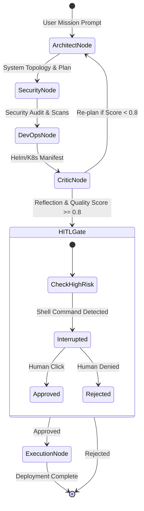

# AgenticDevOps Mesh (GenAI L2 - 44 Days Mysore)

[](https://github.com/ShreyasVavley/genai-l2-agentmesh/actions)
[](https://github.com/langchain-ai/langgraph)
[](https://litellm.ai)
[](https://modelcontextprotocol.io)

An autonomous multi-agent software engineering & DevOps mesh built with **LangGraph**, **LiteLLM Gateway Router**, **Model Context Protocol (MCP)** tool discovery, and **Human-in-the-Loop (HITL)** governance, engineered as the capstone for the **44-Day GenAI Level 2 Mysore Master Program**.

---

## 🎯 Program Curriculum Coverage

This project demonstrates the complete end-to-end integration of all 11 Level 2 syllabus modules:
1. **Agentic AI Foundation and Design Patterns (2 Days)**: ReAct, Plan-and-Solve, Reflection, Critic loops, multi-agent supervisor topology.
2. **Programming Framework for Agentic System (5 Days)**: State machines, node functions, edge routing, typed state graphs.
3. **Agent Persona Modeling, Execution & Inferencing (2 Days)**: Distinct cognitive bounds for `LeadArchitect`, `SecurityAuditor`, `DevOpsEngineer`, and `CriticReviewer`.
4. **Agent Knowledge Base and Human in Loop (5 Days)**: Stateful checkpointing, interrupt condition before destructive actions, resume hooks.
5. **DevOps for Agentic AI Applications (3 Days)**: Docker containerization, asynchronous background execution, graceful shutdown.
6. **Agent Tool Discovery and Communication (8 Days)**: Dynamic tool registry complying with Anthropic's Model Context Protocol (MCP) schema.
7. **Agent Observability (3 Days)**: OpenTelemetry-compatible span tracing, latency profiling, token consumption, and dollar-cost attribution.
8. **Building & Deploying Agents in Automated CI/CD (3 Days)**: Automated GitHub Action regression pipeline (`agent_eval.yml`) and container builds.
9. **LiteLLM & LLM Gateway (3 Days)**: Multi-model fallback (Gemini -> OpenAI -> Local Mock), token tracking, rate limiting.
10. **LangGraph State Management & Control Flow (7 Days)**: `StateGraph`, conditional edges, cyclical reflection loop.
11. **Agent Persona Modeling & Inferencing (3 Days)**: Persona refinement, zero-shot system prompts, temperature steering.

---

## 🏗️ Multi-Agent Architecture Blueprint



---

## 🚀 Quickstart Guide

### 1. Clone & Set Up
```bash
git clone https://github.com/ShreyasVavley/genai-l2-agentmesh.git
cd genai-l2-agentmesh
python -m venv venv
# Windows:
.\venv\Scripts\activate
# Linux/macOS:
source venv/bin/activate
pip install -r requirements.txt
```

### 2. Run the Multi-Agent Cockpit
```bash
uvicorn app.main:app --reload --host 127.0.0.1 --port 8001
```
- **Agent Cockpit Dashboard**: [http://127.0.0.1:8001](http://127.0.0.1:8001)
- **OpenAPI Swagger Specs**: [http://127.0.0.1:8001/docs](http://127.0.0.1:8001/docs)

### 3. Run Automated Agent Evaluation
```bash
pytest tests/ -v
```

### 4. Run via Docker
```bash
docker-compose up --build
```

---

## 📡 API Reference Sample

### Trigger Multi-Agent Run
```http
POST /api/v1/mesh/run
Content-Type: application/json

{
  "prompt": "Architect and deploy an asynchronous payment verification microservice with zero-trust security."
}
```

### Human-in-the-Loop Gate Approval
```http
POST /api/v1/mesh/approve
Content-Type: application/json

{
  "task_id": "a1b2c3d4",
  "approved": true
}
```

### Dynamic MCP Tool Discovery
```http
GET /api/v1/mesh/tools
```

---
© 2026 Mysore GenAI Training Program. Instructor: Shreyas Vavley.
